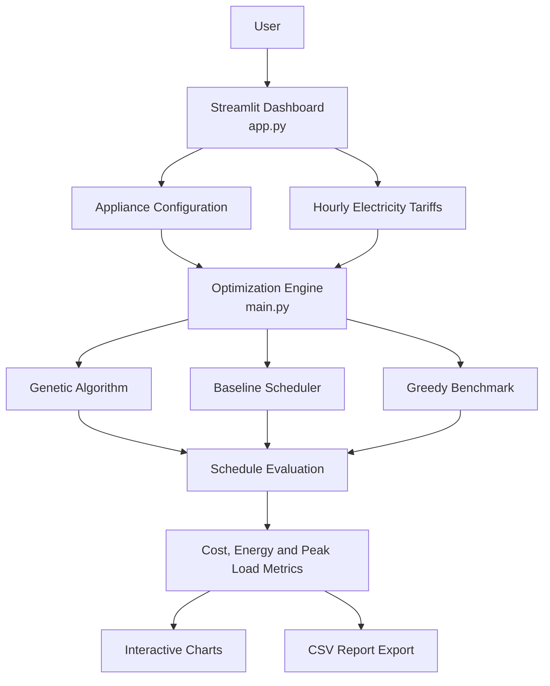

# System Architecture

The project separates the user interface from the optimization logic.

- **`app.py`** provides the Streamlit dashboard and user interactions.
- **`main.py`** contains the optimization engine and scheduling logic.
- **`requirements.txt`** lists the Python packages needed to run the project.
- **`smarthome_config.json`**, when created by the application, stores local configuration data.

